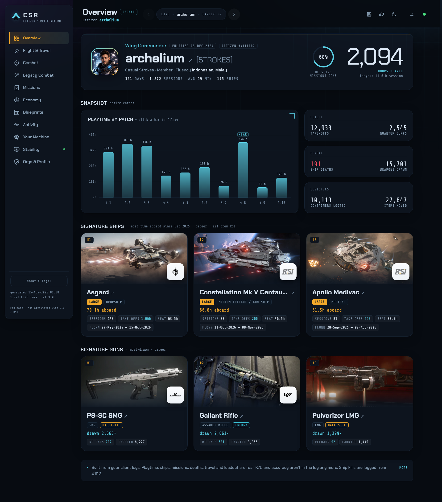
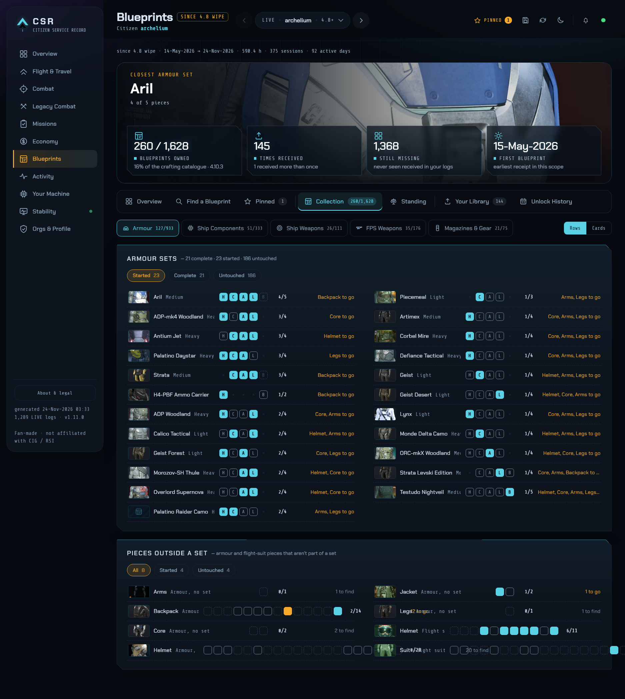
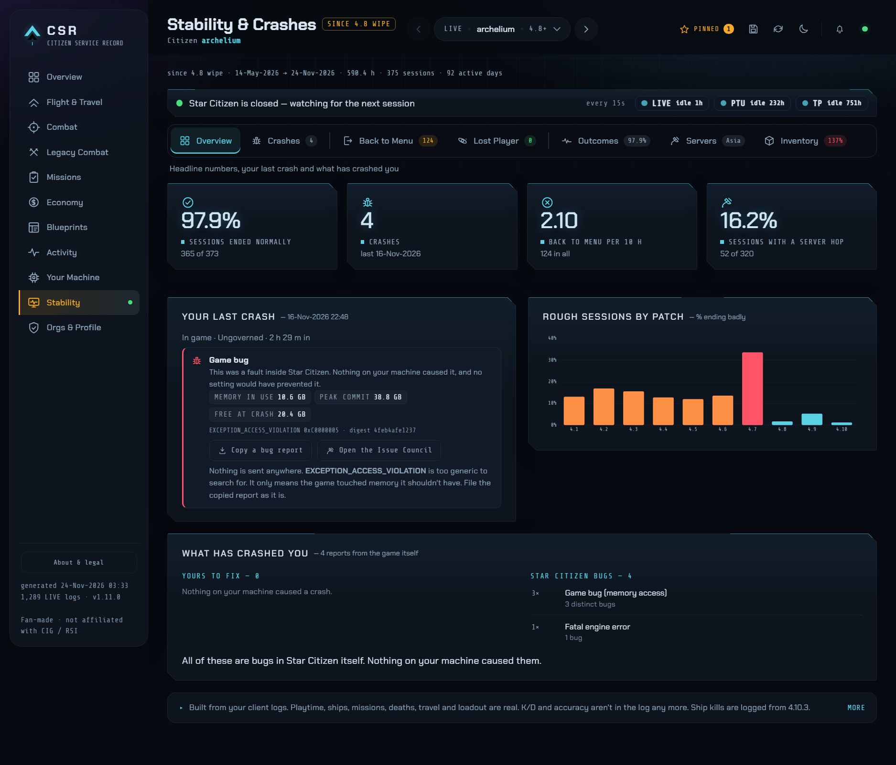
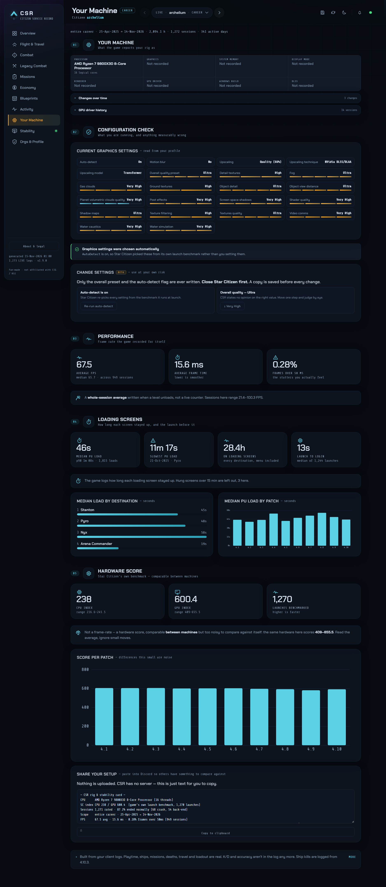
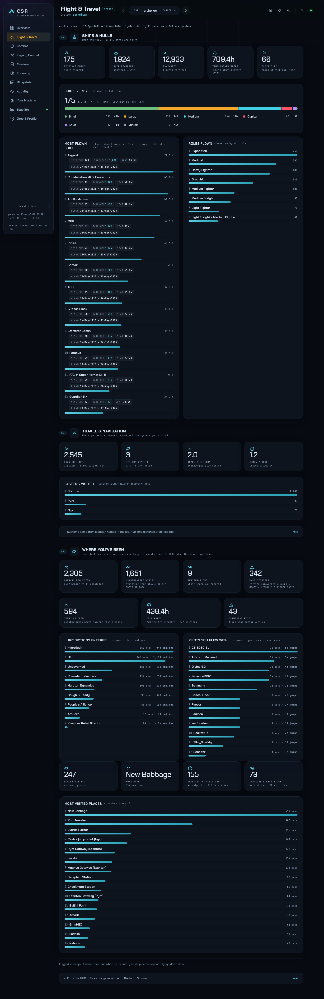

# CSR — Citizen Service Record

A **career-stats dashboard for Star Citizen**. CSR mines your entire client-log
history and builds a single, interactive, HUD-styled web page: playtime, ships
flown, missions, favorite guns, quantum travel, aUEC spent, crafting blueprints —
broken down by patch and by account.

Pure Python **standard library** (no pip installs to run from source).

**Patch coverage — tested on 4.1 → 4.10.3** (November 2026). CSR reads the version out of each
log rather than working from a fixed list, so **older patches will often work too**, and
newer ones should. Neither is tested: Star Citizen changes its log format between
builds, so expect gaps or misparsed figures outside that range — and please
[report them](https://github.com/archelium/csr/issues) if you hit any.




<details>
<summary><b>More screenshots</b> — Blueprints, Stability, Your Machine, Flight &amp; Travel</summary>

### Blueprints

Every crafting blueprint the game has handed you, and every one it hasn't, against the
full ~1,600-blueprint catalogue. Armour is shown as **sets** — a square per slot, sorted by
pieces to go, so you can see which set is one drop from complete — ship weapons as
**S1–S6 ladders**, and components as a **type × size grid**.



### Stability

Crashes named in the game's own words, split into ones you can fix and Star Citizen
bugs. Each crash row says what you were doing, where, and how long you'd been in.
Repeats of the same bug fold into one *crash loop* row. Also **returns to the main
menu mid-session** — the "it booted me for no reason" moment, which Star Citizen records
as *you* asking to disconnect, and which nothing else counts. Since the 2026 builds a
deliberate *Exit to menu* leaves the same trace, so CSR counts both and says so. Then the
servers you joined: region, distinct servers, and hops between them. And your **home
inventory**: how full it is against its 5,000 SCU cap, sorts that fail, and inventory
requests that grow past what the game will send.



### Your Machine

The rig the game saw, your graphics settings in the menu's own wording, a
configuration check that flags what is measurably wrong, and how long your loading
screens take, by destination and by patch.



### Flight &amp; Travel

Ships flown, time aboard and in the pilot seat, hull-size mix, roles, quantum travel,
and the places you've been: stations, cities, rest stops and outposts, most visited
first.



</details>

---

## Get started

Pick whichever fits you:

### 1. The app (recommended — no Python needed)
**Extract the zip**, then double-click **`CSR.exe`**. Your browser loads the dashboard at
`http://127.0.0.1:7878`, and CSR's icon appears in the notification area by the clock
(behind the ^ arrow if Windows hides it).

- **First run:** CSR tries to auto-detect your install. If it can't, it pops up a
  folder picker — choose your **`StarCitizen`** folder (the one that *contains*
  `LIVE`, and `PTU` / `TECH-PREVIEW` if you have them), so CSR can build a
  separate career for each channel. Picking a single `LIVE` folder also works —
  CSR finds its siblings automatically.
- **Refresh:** the **⟳** button (top-right of the page) re-scans your logs. It only
  re-reads files that changed, so it takes about a second; **Full re-scan** is there
  for after a CSR update.
- **CSR lives in the tray.** No console window. Click the icon to open the dashboard.
  Right-click it for Refresh logs, **Start with Windows**, Open log, Open data folder and
  Quit. Crashes and disconnects pop up as Windows notifications while you play. The
  **status light** at the top-right of the page restarts or shuts CSR down too. Starting
  `CSR.exe` again while it runs just opens the dashboard. Its output goes to
  `CSR-data\csr.log`. Start it with `--console` to see it in a window instead.
- **Self-contained / portable:** CSR keeps its config, generated page and cached
  art in a **`CSR-data` folder right next to the exe** — delete that folder to wipe
  everything, or run the whole thing from a USB stick with no trace left on your
  PC. (If you put the exe somewhere read-only like *Program Files*, it falls back
  to `%LOCALAPPDATA%\CSR`.) **Nothing leaves your PC** except fetching ship/weapon
  artwork and your public RSI profile.

> Run it from a normal folder you extracted it to (Desktop, Downloads, a folder
> you made) — not from *inside* the zip, or its data won't stick.

> Windows may show a blue **SmartScreen** "unknown publisher" warning (the exe
> isn't code-signed). Click **More info → Run anyway**.

### Updating from an earlier version

CSR is portable, so updating is just **replace the exe**:

1. Close CSR — **Quit CSR** from the tray icon, or **Shut down** in the status light.
2. Extract the new `CSR.exe` **over the old one**, in the same folder.
3. Start it. That's it — your settings, cached artwork and career history live in
   the `CSR-data` folder beside the exe and are picked up automatically.

**Don't delete `CSR-data`** — from v1.1.0 on it holds your session *archive*, which
keeps sessions Star Citizen has since deleted from your log folder. If you want a
belt-and-braces backup first, open CSR and use **💾 Backup & transfer → Export**.

What happens on your first run of v1.11.0, depending on where you're coming from:

| Coming from | What to expect |
|---|---|
| **v1.0.0** | v1.0.0 kept no archive, so your history is rebuilt from whatever logs you still have. If your saved folder was `…\StarCitizen\LIVE`, CSR now finds `PTU` and `TECH-PREVIEW` beside it on its own — **no need to re-pick a folder** — and a **Channel** dropdown appears if it finds any. |
| **v1.1.0 – v1.10.0** | Your archive carries over untouched. |
| **v1.0.0 – v1.9.1** | The first scan re-reads **every** log (a minute or so). This is deliberate: each release fixes parsing bugs or extracts new data, so nothing older is trusted. It happens once — after that CSR starts, and refreshes, in about a second. |
| **v1.9.2 – v1.10.0** | No re-read. CSR opens on your stats since the 4.8 wipe, with Career one click away. |

Coming from **v1.2.0** specifically, the first run also *moves* some existing numbers,
because v1.3.0 converts session times from the log's UTC stamps to your own clock: the
weekday × hour heatmap shifts by your timezone offset, and a late-night session can move
to the previous or next day. That is a correction, not a regression — v1.2.0 was plotting
a 10pm session at 3pm on this machine.

Numbers may *change* after updating — that's the point. Patch 4.1 gained reloads and
item transfers it never had; some stats that used to read `0` now correctly read
`N/A` (see the CHANGELOG for exactly which, and why).

One limit worth knowing: sessions already in your archive whose original logs Star
Citizen has since **deleted** can't gain data from a newer parser — there's nothing
left to re-read. In *Stability* those sessions are counted as **unrated**
and said so, rather than being assumed to have ended well.

### 2. From source, as the app
```bash
python sc_stats.py --serve      # or double-click "Start CSR.bat"
```
Same experience as the exe (folder picker, Refresh button), but needs Python 3.9+.

### 3. From source, one-shot static file
```bash
python sc_stats.py --open       # writes + opens CSR.html, then exits
python sc_stats.py --live "D:\...\StarCitizen\LIVE"   # point at a specific LIVE folder
```
Produces a **single `CSR.html`** you can open any time or
share. Ship and item pictures load from RSI, starcitizen.tools and xparrow-lite when you view it. (No server, so no in-page Refresh button — re-run to update.)

---

## What's in the dashboard

A left sidebar of pages; a top bar with an **account** dropdown, a **scope** dropdown
(*Since 4.8 wipe*, which CSR opens on, then *Career*, *Before 4.8 wipe* and every patch
found in your logs), a light/dark toggle, and Refresh. Each page has a menu across the
top: one tab per section, with its icon and headline number, and one section on screen
at a time. The layout fits phones and tablets too. Everything is scoped by account ×
scope. On **Overview**, click any bar in *Playtime by Patch* to filter to that patch (and
*↩ Since 4.8 wipe* to go back).

- **Overview** — RSI profile, snapshot KPIs, click-to-filter playtime-by-patch,
  signature top-3 ships (by time aboard) & guns with artwork
- **Flight & Travel** — where you've been (jurisdictions, landing-zone visits, hangars requested, jumps as crew and the pilots you flew under, time in a party, CrimeStat rises — from the HUD notices, 4.5+), *places visited* (every station, city, rest stop and outpost you landed or docked at, your home base, the 15 you visit most), *ships & hulls* (distinct ships, boardings, take-offs, time aboard ships, fleet
  size, most-flown by time aboard with seat time and first/last flown dates, hull-size mix, roles) and
  *travel & navigation* (quantum jumps, jumps per session/hour, systems visited)
- **Combat** — *ship combat* (how you lost ships, and from 4.10.3 the ships you destroyed:
  kills, crippled, other players' ships, kills per 10 hours, the ships you destroyed most,
  and who destroyed yours), *FPS combat* (loadout ranked by
  how often each weapon was drawn, plus reloads and carry), *injuries & treatment*
  (what hurt you, med-bed surgeries, hospital vs ship medbay, time out of air and how
  often with no helmet on), *gear lost on death*
  (items and guns lost, what you lose most often), and *looting & inventory*
  (containers looted, items transferred, corpse loots)
- **Legacy Combat** — real PvP/PvE kills & K/D from patches 4.1–4.3 (PU vs Arena
  Commander toggle) — the only builds that still logged combat client-side
- **Missions** — outcomes, completion rate, mission types, contracts by name (4.5+), and cargo hauling: SCU delivered by commodity and destination
- **Economy** — **real aUEC spent**, top items bought, what you buy, cargo & commodities
- **Blueprints** — every crafting blueprint the game has handed you (4.7+), searchable, plus what you're still missing against the full ~1,600-blueprint catalogue; its own menu of pages: armour as sets (which one is a piece from complete), ship weapons as S1–S6 ladders, components as a type × size grid, every blueprint as a card, search and pins. Click any blueprint for the missions that drop it, the faction standing they need, and the reputation floor your completed contracts put you at
- **Activity** — playtime by month, where your hours go (starting up, loading screens,
  main menu, aboard a ship, on foot), weekday×hour heatmap, session-length mix, streaks
- **Your Machine** — the rig you played on (CPU, GPU + VRAM, memory, driver, renderer,
  Windows build) and when it changed; a **configuration check** that flags measurable
  problems (most usefully: *Star Citizen is rendering on the wrong graphics card*);
  **frame rate** per session; **loading screens** (median PU load, the slowest, total
  time spent on them, launch to login, by destination and by patch); the game's own
  hardware benchmark; and a **shareable rig card**
- **Stability** — everything that goes wrong, with a **live dot in the sidebar** that
  pulses while CSR is tailing your logs:
  - **Crash analysis** naming the fault in the game's own words, split into faults you
    can fix and Star Citizen bugs. **Every crash listed** (paged, newest first) with what
    you were doing, where, and how long you'd been in. The same bug crashing again within
    30 minutes is one *crash loop* row. A **Copy a bug report** button formats build,
    exception, crash digest, memory, rig and the last errors for an Issue Council filing
  - **Lost your player** — the soft crash where the game keeps running but you have no
    body and the starmap won't plot a route. Counted per episode, with a rate per 10 hours
    and a monthly trend
  - **Back to the main menu** — the "it just booted me for no reason" moment, counted
    for the first time. Star Citizen logs it as *you* asking to disconnect, which is why
    nothing has ever counted it. Since the 2026 builds a deliberate *Exit to menu* looks
    identical in the log, so the figure includes both, is labelled that way, and is
    reported as a rate per 10 hours played with a by-month trend
  - How your sessions **ended**, per patch
  - **Servers** — your main region, joins by region, distinct servers joined, and server
    hops (a different server in the same session) per patch
  - **Home inventory** — how full your home inventory is (used SCU against its cap, by
    month), failed sorts, the largest inventory request against the 1 MB the game will
    send, operations dropped over that limit, and reward items announced
- **Live crash alerts** — while CSR is running it watches your log and pops an alert on
  the dashboard within seconds of a crash, a lost player or a genuine disconnect, saying what broke and
  whether it was your PC or CIG's servers. Routine disconnect chatter is filtered out.
  A **🔔 bell in the top bar** carries a badge and keeps every alert raised while the page
  has been open; the line at the top of every *Stability* page shows the watcher's status lights. CSR also checks whether
  `StarCitizen.exe` is running, so it knows the difference between a log being written
  because you're playing and one being written as the game shuts down — it reads only the
  process *name*, the same thing Task Manager lists, and never opens a handle to the game
- **Orgs & Profile** — RSI dossier + public orgs (main + affiliates)

Stats the game stopped recording (or never did) show **N/A** rather than a
misleading `0` — see the CHANGELOG for which, and why.

### Playing on more than one PC

Star Citizen deletes old logs, and each machine only ever sees its own. CSR keeps a
running **archive** so your career survives both. Open **💾 Backup & transfer**:

| You have | Use |
|---|---|
| A **log folder copied** from the other PC | **Import logs** → pick the folder, or paste its path. CSR reads it straight off disk — you don't need to install CSR over there. |
| CSR **installed on both** machines | **Export** on the other PC, then **Import backup** here. |
| Just want a safety copy | **Export** — one file with your whole career. |

Sessions merge and de-duplicate by identity, so importing the same folder or file
twice never double-counts. Copied logs still declare which channel they came from,
so they land in the right career even if you dropped them in the wrong folder.

> **Known issue.** The *Choose log folder…* dialog is a native Windows one, and Windows
> often opens it **behind** your browser — check the taskbar if the button seems to hang.
> The **"or paste the folder path"** box next to it doesn't depend on window focus and
> always works.

Everything is real, from your logs. Backend class IDs become in-fiction names
(`RSI_Zeus_ES` → **Zeus Mk II ES**, `klwe_rifle_energy_01` → **Klaus & Werner
Gallant**); ship names/art come from the official **RSI Ship Matrix**, item names
from the **SC-Wiki** item data. Fonts and maker logos are embedded. Ship, gun, item
and place pictures load from RSI and starcitizen.tools as you scroll. Items the wiki has no
picture of use an icon from [xparrow-lite](https://xparrow-lite.pages.dev), a Star Citizen
fan site, loaded the same way and never stored. Offline, each picture slot shows its icon
and everything else works.

**What CSR can't show** — on-foot kills, K/D, accuracy, damage, and your aUEC *balance /
earnings*: Star Citizen stopped writing those to the client log in the 2026 builds
(combat + wallet went server-side). Ship kills came back in 4.10.3 and are counted from
there. aUEC **spend** *is* logged (per shop purchase),
so the Economy tab is real. "Favorite guns" is by **times drawn into your hand**,
not shots fired. Frame rate **is** recorded, but as a **whole-session average**
written when a level unloads — not a live counter, so a session that ran at 90 FPS in
space and 30 in a city averages out in between.

**CSR won't claim to know your optimal settings.** A session average is too coarse to
judge one settings change against another. What it does instead:

- **Diagnoses** — your settings as the game stores them, plus a short list of things
  that are objectively wrong or below CIG's published requirements (most usefully:
  *Star Citizen is rendering on the wrong graphics card*).
- **Delegates** — one click re-runs Star Citizen's own **auto-detect**, which picks
  every setting from the benchmark the game runs on your hardware. That's CIG's
  calibration, and it beats any rule of thumb CSR could apply.
- **Nudges** — moves the overall quality preset one step so you can judge for yourself.

CSR only ever writes those **two values**, never the individual quality sliders. Your
settings file is **backed up before the first change**, writes are refused while Star
Citizen is running, and **one click restores the original**.

---

## Building the exe

```bash
build_exe.bat          # installs PyInstaller if needed, then builds dist\CSR.exe
```
or manually: `python -m PyInstaller csr.spec --noconfirm`. The one-file exe
(~9 MB) bundles the game-data caches; share that single file. To give it an icon,
drop a `csr.ico` next to `csr.spec` and rebuild.

---

## Files

| File | Purpose |
|------|---------|
| `sc_stats.py` | ⭐ The whole app — log scan → aggregate → HTML/CSS/JS dashboard + `--serve` local app. |
| `sc_names.py` | Name resolution & web fetch: ship matrix, item names, RSI profile/orgs, artwork + fonts → data URIs. |
| `csr_tray.py` | The tray icon, its menu, Windows notifications and Start with Windows (plain Windows API, no extra packages). |
| `csr.spec`, `build_exe.bat` | PyInstaller build for `dist/CSR.exe`. |
| `Start CSR.bat` | Double-click launcher for the source app. |
| `sc_*.json`, `sc_fonts_embed.css` | Cached game data / fonts (delete to refetch). |
| `sc_analyzer.py` | **Deprecated** live death-tracker (kept for reference; not maintained). |
| `make_release.py` | Assembles the download zip: the exe plus the docs as plain `.txt`, and prints the SHA-256 hashes with their VirusTotal links. |
| `docs/RELEASING.md` | Release checklist: build, scan on VirusTotal, report false positives, publish. |
| `tools/make_icon.py` | Draws the chevron mark → `csr.ico`. Developer tool, **not** part of the app: it's the one file needing a package (Pillow), and the generated `.ico` is committed so a clone builds without it. |
| `tools/make_social.py`, `tools/shoot.py` | Developer tools: the GitHub social-preview card, and the README screenshots (headless Edge over DevTools, standard library only). |

---

*CSR reads only your local Star Citizen logs and your public RSI profile. It never
sends your data anywhere.*
